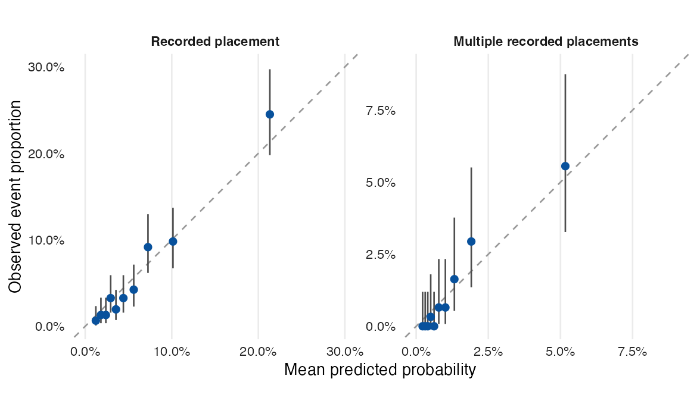

# Predicting Out of Home Placement

ODH · Research report

[Report + SI](ms/main.pdf) · [HTML report](ms/main.html) · [Supplement](ms/supplement.pdf) · [HTML supplement](ms/supplement.html)

## Question and design

What predicts recorded behavioral health out-of-home placement, multiple
placements, and occupied days among youth in the PerformCare extract? The analysis
uses information recorded before a fixed forecast origin and evaluates lasso
models on outcome-stratified held-out youth. Paired model comparisons and 20
repeated stratified splits assess the value of added record indicators. Alternative horizons and CANS scoring rules are reported
together.

The models distinguish risk within this historical cohort. The sample was selected
partly using events during the prediction period, and the extract does not
establish complete ascertainment of placements. These results therefore describe
recorded outcomes in the supplied cohort; they do not validate prospective clinical
use, discharge-indexed readmission risk, or an intervention to prevent placement.



The report compares how many youth with subsequent recorded placements are
identified at the same assessment capacity by the full model, CANS and demographics,
prior placement history, and random selection. It also reports discrimination,
calibration, and probability accuracy. The supplementary information examines a
calendar-year 2015 endpoint and rolling forecasts with explicit history, lead-gap,
and outcome windows. Case-finding gains do not establish treatment benefits or
placements prevented.

## Reproduce

With R, Pandoc, XeLaTeX, Ghostscript, and the authorized source data available:

```sh
make restore
make check
```

`renv.lock` pins the tested R package versions. `make check` rebuilds the analysis,
audit, figures, PDF and HTML manuscript, runs `testthat`, and lints the maintained R
code. `make format` applies tidyverse formatting. `make ci-docker` provides the same
workflow in a standard Rocker image; the local source data must be mounted and remain
subject to their access restrictions. The Docker target is optional.

## Files

| Path | Contents |
|---|---|
| `R/data.R` | Date parsing, module scoring, recorded outcomes, interval union, record indicators |
| `R/models.R` | Development-only preprocessing, tuning, lasso fitting, held-out metrics, bootstrap and exact binomial intervals |
| `R/presentation.R` | Shared figure and table styles using standard libraries |
| `scripts/prepare.R` | Raw-to-analysis construction, descriptive summaries, input hash verification |
| `scripts/audit.R` | Reconstruct historical calculations and count the verified defects |
| `scripts/estimate.R` | Stratified person split, main models, and all sensitivity specifications |
| `scripts/targeting.R` | Equal-capacity comparisons and annual versus longer-window rankings |
| `scripts/rolling.R` | Earlier-period training and later held-out evaluation over sliding histories and targets |
| `scripts/stability.R` | Paired model comparisons, Brier skill, and 20 repeated stratified splits |
| `scripts/descriptive.R` | Person-level diagnosis, medication, eligibility, and demographic summaries |
| `scripts/figures.R` | Generated figures from shared computed summaries |
| `scripts/render.R` | PDF and HTML rendering; main PDF includes the report followed by the SI |
| `ms/main.Rmd` | Maintained research report with generated tables and inline results |
| `ms/supplement.Rmd` | Calendar-year 2015 sensitivity and rolling-forecast supplementary information |
| `ms/references.bib` | Cited literature, checked against publisher and Crossref records |
| `tabs/` | Aggregate outputs, coefficients, tuning losses, performance and audit counts |
| `figs/` | PDF and PNG exhibits |
| `docs/` | Audit ledger, editorial changes, source inventory and package session |
| `tests/testthat/` | Boundary, overlap, missingness, leakage and output checks |
| `data/` | Original inputs and local derived data; see [data documentation](data/README.md) |
| `archive/` | Original writing and other archive contents, preserved byte-for-byte |

Individual-level records and predictions are excluded from version control; no
redistribution license for the clinical data is implied.
